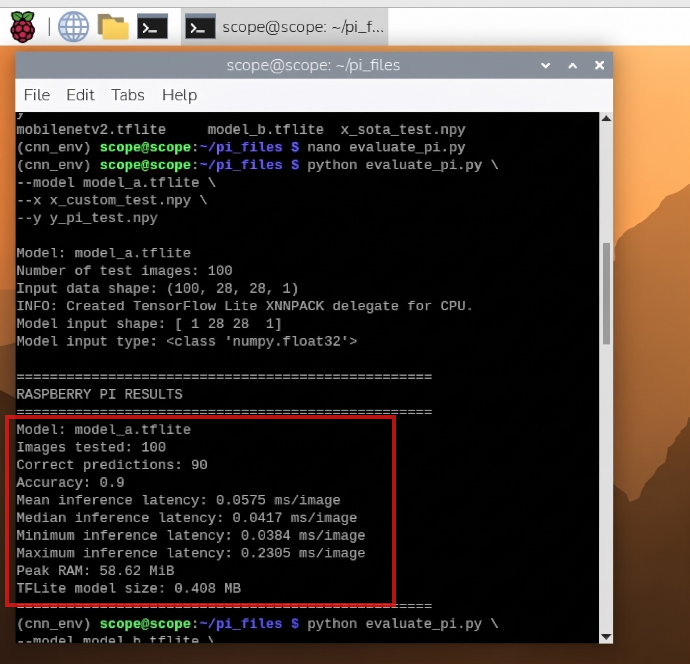
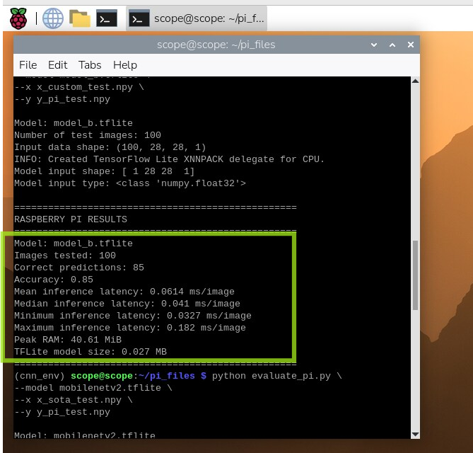
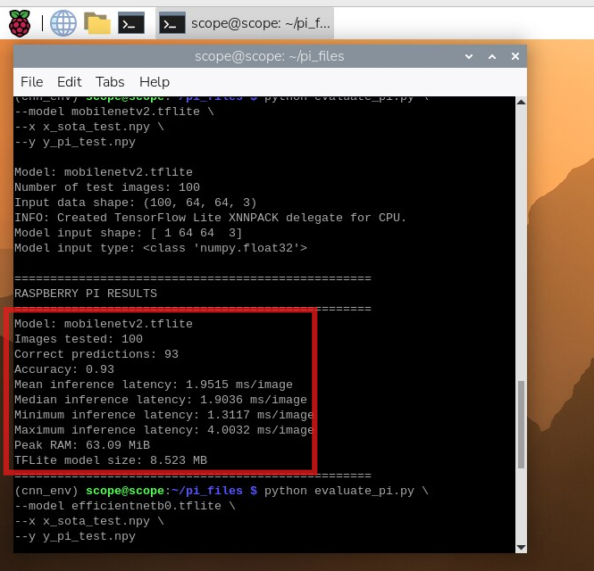
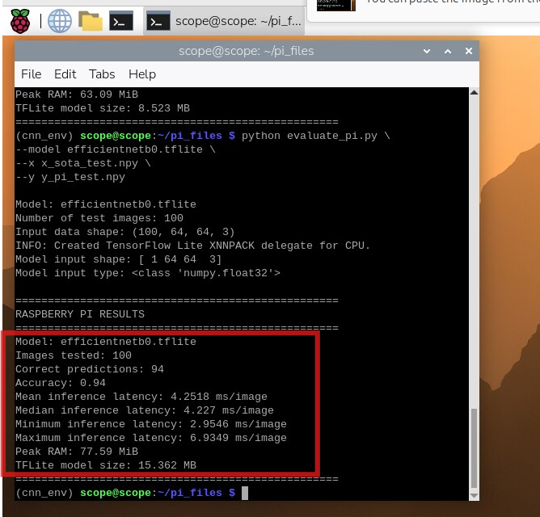

# Resource-Constrained CNN for Edge Image Classification

This project was developed for the **EN3150 – Pattern Recognition** module at the University of Moratuwa.

The main objective of the project is to design and evaluate a lightweight Convolutional Neural Network (CNN) suitable for image classification on resource-constrained edge devices.

The **Fashion-MNIST** dataset was used for the experiments. Two custom CNN architectures were developed and compared with two lightweight pre-trained deep learning models:

- **Model A** – Standard CNN using normal 2D convolutions
- **Model B** – Lightweight CNN using depthwise separable convolutions
- **MobileNetV2**
- **EfficientNetB0**

The models were trained using **TensorFlow/Keras in Google Colab** and later converted to **TensorFlow Lite (TFLite)** for deployment and evaluation on a **Raspberry Pi**.

The project uses the **Fashion-MNIST** dataset.Each image is a grayscale clothing image with a resolution of 28 × 28 × 1 with 10 classes.

# Workflow

```text
Fashion-MNIST
      ↓
Data Preprocessing
      ↓
Train Models in Google Colab
      ↓
Evaluate Models
      ↓
Convert Models to TensorFlow Lite
      ↓
Transfer .tflite Models to Raspberry Pi
      ↓
Run Inference on Raspberry Pi CPU
      ↓
Measure
 ├── Accuracy
 ├── Inference Latency
 ├── Peak RAM
 └── Model Size
```
# Results

<table>
<tr>
<td align="center">

</td>

<td align="center">

</td>

<td align="center">

</td>

<td align="center">

</td>
</tr>

<tr>
<td align="center"><b>Model A</b></td>
<td align="center"><b>Model B</b></td>
<td align="center"><b>MobileNetV2</b></td>
<td align="center"><b>EfficientNetB0</b></td>
</tr>
</table>

---

## Comparison

| Model | Accuracy* | Mean Inference Latency | Peak RAM | TFLite Model Size |
|---|---:|---:|---:|---:|
| **Model A** | 90% | **0.0575 ms/image** | 58.62 MiB | 0.408 MB |
| **Model B** | 85% | **0.0614 ms/image** | **40.61 MiB** | **0.027 MB** |
| **MobileNetV2** | 93% | 1.9515 ms/image | 63.09 MiB | 8.523 MB |
| **EfficientNetB0** | **94%** | 4.2518 ms/image | 77.59 MiB | 15.362 MB |

> **Note:** The accuracy values in this table correspond to the 100-image Raspberry Pi deployment subset. Full test-set accuracy is evaluated separately in the training notebook.

# Main Trade-Off

The experiment demonstrates that no single architecture is best for every requirement.

| Priority | Suitable Model |
|---|---|
| Minimum storage | **Model B** |
| Minimum RAM usage | **Model B** |
| Very low computational requirement | **Model B** |
| Higher custom-CNN accuracy | **Model A** |
| Good accuracy with moderate edge requirements | **MobileNetV2** |
| Highest accuracy among tested models | **EfficientNetB0** |

